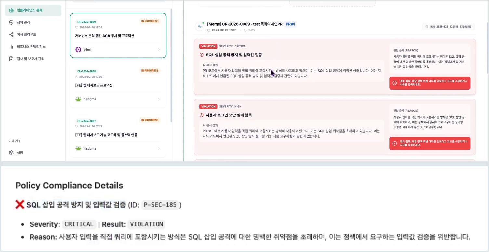
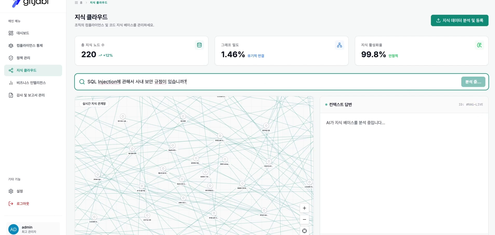
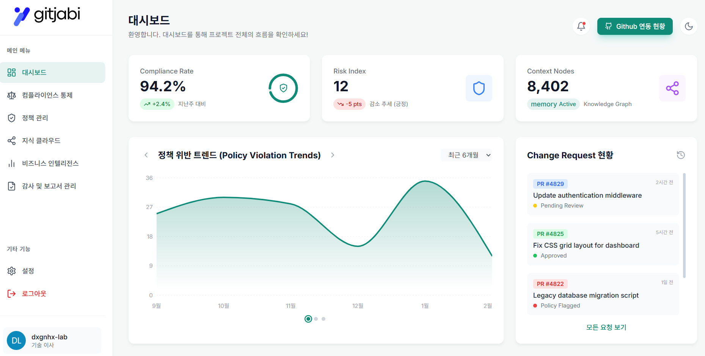
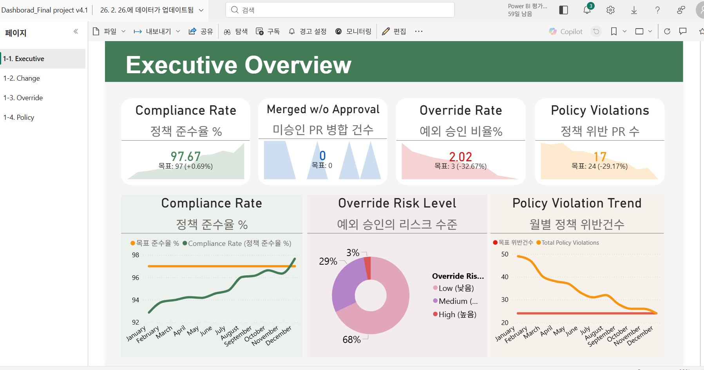
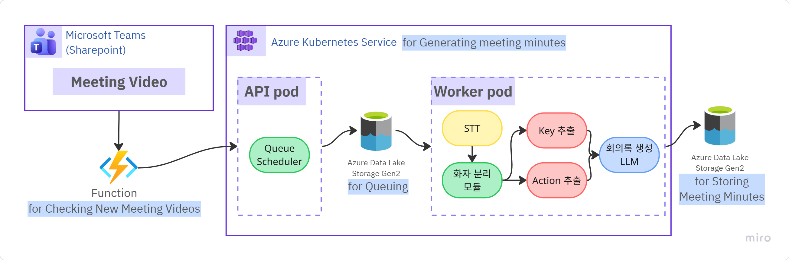

# GitJabi · 깃잡이

**GitHub의 코드 변경을 조직의 규정과 대조하고, 검토 근거와 승인 이력을 한곳에 모으는 IT 거버넌스 플랫폼입니다.**

팀의 개발 기준은 정책 문서에 있고, 예외를 허용한 이유는 회의록에 남고, 실제 변경은 GitHub에서 일어납니다. GitJabi는 이 세 가지를 **변경 요청(Change Request, CR)** 단위로 연결합니다. 개발자는 PR에서 검토 결과를 확인하고, 승인자는 관련 정책과 분석 근거를 살펴본 뒤 결정을 남깁니다. 관리자는 반복되는 위반과 예외 승인 추이를 대시보드에서 확인할 수 있습니다.

**Microsoft Data School 2기 최종 프로젝트 · 5인 팀 · 최우수상**  
개발 기간 2026.01.28–02.26 · 최종 발표 2026.02.27

## 주요 화면

| 코드 변경 검토 | 정책 지식 탐색 |
| --- | --- |
| [](assets/gitjabi-pr-review.png) | [](assets/gitjabi-knowledge-cloud.png) |
| 같은 PR의 검토 결과를 GitJabi와 GitHub Checks에서 확인합니다. | 지식 클라우드에서 정책을 질문하고 답변과 연결된 노드를 살펴봅니다. |
| **개발자용 대시보드** | **관리자용 Power BI 보고서** |
| [](assets/gitjabi-developer-dashboard.png) | [](assets/gitjabi-executive-overview.png) |
| 최근 변경 요청의 검토 상태와 정책 위반 추이를 함께 봅니다. | 정책 준수율, 미승인 PR 병합 건수, 예외 승인 비율을 기간별로 확인합니다. |

화면의 수치는 프로젝트 시연 데이터입니다. 이미지를 선택하면 원본 크기로 열립니다.

## 변경 요청한 건은 어떻게 처리되나요?

GitHub의 **PR**은 어떤 코드를 바꾸려는지 보여줍니다. GitJabi의 **CR**은 그 변경에 어떤 정책이 적용됐고, 누가 어떤 근거로 결정했는지 기록하는 단위입니다.

1. **변경 접수** — GitHub에서 PR 이벤트가 발생하면 Webhook을 통해 메인 API가 변경 정보를 받아 CR과 연결합니다.
2. **적용 정책 선별** — 정적 규칙으로 변경 규모와 파일·코드 패턴을 점검합니다. 별도로 LLM이 PR과 코드 차이를 요약하면, 그 내용으로 정책 후보를 검색하고 관련도와 키워드를 추립니다.
3. **근거 검색과 평가** — 정책 노드 간 연결과 Azure AI Search를 이용해 관련 문서·유사 사례를 찾습니다. LLM이 코드 변경과 검색된 근거를 함께 읽고 준수·위반 여부와 판단 이유를 생성합니다. 개발자는 GitHub Checks에서 결과를 확인합니다.
4. **검토자의 결정** — CR에 배정된 검토자는 GitJabi에서 분석 결과를 보고 승인·거절·예외 처리를 선택합니다. 서버는 검토자별 상태, 의견, 결정 시각을 기록합니다. 배정된 검토자가 모두 승인하면 CR 상태가 승인 완료로 바뀝니다.
5. **운영 추적** — 개발팀은 개별 CR의 진행 상황을 확인하고, 관리자는 Power BI에서 어떤 정책의 위반이 반복되는지, 예외 승인이 어떻게 변하는지 살펴봅니다.

[전체 아키텍처](assets/Overview%20Architecture.png) · [정적 검사·검색·평가 흐름](governance-engine/governance_engine/engine.py) · [근거 검색 코드](governance-engine/governance_engine/rag_node_searcher.py) · [CR 결정 처리 API](gitjabi-main-backend-api/src/app/routes/dashboard_crs.py)

## 정책 문서와 회의 기록은 어떻게 검색되나요?

### 회의 녹화에서 회의록까지

Teams 회의 녹화가 SharePoint에 저장되면 Azure Functions가 새 파일을 감지하고 Azure Storage Queue에 처리 작업을 등록합니다. 시간이 오래 걸리는 음성 처리는 워커에서 수행합니다.

| 단계 | 처리 결과 |
| --- | --- |
| 음성 인식 · WhisperX | 녹화 파일의 음성을 시간 정보가 있는 발화 텍스트로 변환합니다. 화자 분리를 사용하면 누가 말했는지도 구분합니다. |
| 발언 분류 · KoELECTRA | 발화를 핵심 쟁점·결정(`key`), 후속 조치(`action`), 그 밖의 맥락(`other`)으로 분류합니다. |
| 회의록 작성 · Llama | 발화와 분류 결과를 바탕으로 논의 내용과 실행 항목을 정리합니다. 완성된 회의록은 Markdown으로, 메타데이터는 JSON으로 저장합니다. |



[회의록 모듈 실행 예제](gitjabi-meeting-minutes-generator/README.md) · [단계별 입출력 명세](gitjabi-meeting-minutes-generator/PIPELINE_DATAFLOW.md)

### 문서에서 정책 지식그래프까지

ADLS에 들어온 정책 문서와 회의록을 Databricks Auto Loader가 감지합니다. 추출 단계에서는 LLM으로 정책과 근거를 노드로 구조화하고, 개인정보 마스킹과 접근 권한 매핑을 적용합니다. PostgreSQL은 정책 레코드와 이력을 관리하고, Azure AI Search는 질문이나 코드 변경에 관련된 근거를 찾는 데 쓰입니다.

이 데이터는 두 곳에서 활용됩니다. **PR 검토**에서는 평가 엔진이 변경과 관련된 정책 근거를 찾습니다. **지식 클라우드**에서는 사용자가 자연어로 질문하면 RAG API가 접근 권한에 맞는 근거를 검색해 답변을 만들고, 화면에서 관련 노드를 함께 보여줍니다.

[지식 클라우드 화면 코드](gitjabi-frontend-react/components/KnowledgeCloud.tsx) · [지식 검색·답변 API](gitjabi-main-backend-api/src/app/routes/knowledge_cloud.py)

## 저장소 구성과 실행

| 디렉터리 | 담당 기능 |
| --- | --- |
| [gitjabi-frontend-react](gitjabi-frontend-react/) | React·TypeScript 웹 앱. 대시보드, 변경 요청 검토, 지식 클라우드, BI 화면 |
| [gitjabi-main-backend-api](gitjabi-main-backend-api/) | FastAPI 메인 서버. GitHub 연동, CR 조회·결정 기록, 지식 검색 API |
| [governance-engine](governance-engine/) | PR 정적 검사, 정책 후보 선별, 관련 노드 검색, 거버넌스 평가 |
| [gitjabi-nlp-engine-api-docker](gitjabi-nlp-engine-api-docker/) | Kiwi·KeyBERT·CrossEncoder 기반 텍스트 분석과 관련도 평가 |
| [gitjabi-meeting-minutes-generator](gitjabi-meeting-minutes-generator/) | 녹화 수집, 큐 처리, 음성 인식, 발언 분류, 회의록 생성 |
| [infra](infra/) · [tests](tests/) | 인프라 구성과 테스트 자료 |

**웹 화면을 로컬에서 열려면** 저장소 루트에서 다음 명령을 실행합니다.

```bash
cd gitjabi-frontend-react
npm install
npm run dev
```

위 명령은 Vite 개발 서버를 시작합니다. 실제 PR 이벤트를 받거나 저장된 CR·정책 데이터를 조회하려면 메인 API와 GitHub App, 데이터베이스, Azure 서비스 연결 설정이 필요합니다. [메인 API 설정 및 실행](gitjabi-main-backend-api/README.md) · [회의 녹화 수집기 설정](gitjabi-meeting-minutes-generator/functions_poller/README.md) · [회의록 워커 배포](gitjabi-meeting-minutes-generator/deploy/aks/README.md) · [트러블슈팅 기록](TroubleShootings.md)

## 팀

| 이름 | 주요 담당 |
| --- | --- |
| 강동하 | 팀장. 정책 평가 절차와 변경 요청 승인 로직 설계 |
| 김은애 | 거버넌스 위반·리스크 데이터 분석 및 대시보드 시각화 |
| 우승현 | 회의 데이터 수집과 회의록 자동 작성 ML 파이프라인 구축 |
| 이대건 | 서비스 기획, 실시간 데이터 ETL·DB 구축, 핵심 NLP 엔진 |
| 최영동 | 거버넌스 지식 DB·RAG 설계 및 구현, 지식 클라우드 탭 프론트엔드·백엔드 구현 |
