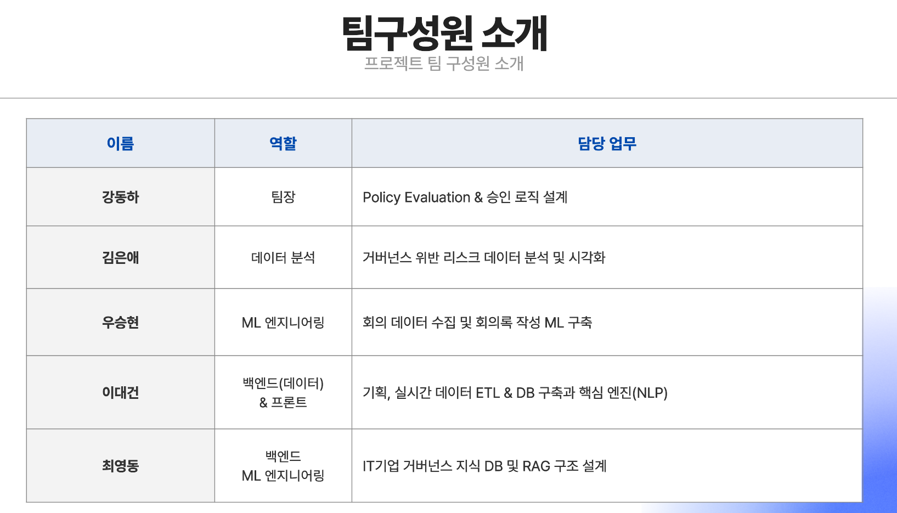

# GitJabi: 지식그래프 및 클라우드 기반 지능형 IT 거버넌스 플랫폼 (Github 연동)

지식 그래프 및 클라우드로 조직의 지식을 자산화하고, GitHub 상에서 기술 정책을 실시간 집행하며 BI 분석을 제공하는 지능형 엔지니어링 거버넌스 플랫폼

## 프로젝트 개요

Microsoft Academy - Dataschool 2nd **최우수상** (2026. 02. 27.)

| 팀명/프로젝트명 | GitJabi                                        |
| :-------------- | :------------------------------------------------------------------ |
| 기간            | 2025. 01. 28 ~ 2025. 02. 26. |
| 인원            | 강동하 김은애 우승현 이대건 최영동                                  |
| 기술            | 하단 `주요 기술` 항목 참조.                                       |

## 기여

## 주요 기술

## 플로우 차트

