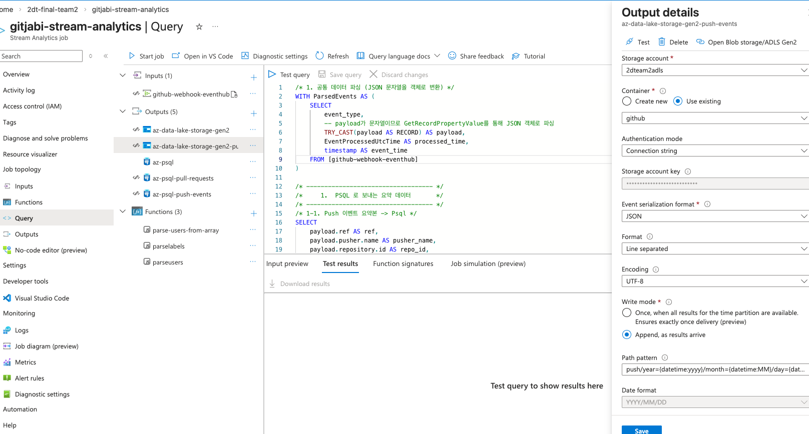

# Stream Analytics

Github Web Hook (Event) --> APIM --> Event Hub --> Stream Analytics --> Database (PSQL, ADLS Gen2 ...) --> Databrics / BI Tool

위와 같은 구조를 이루기 위해 SA는 실시간 데이터 변환 및 분배-적재를 담당하게 된다.

## Input

입력은 이벤트 허브를 통해 받아온다.

## Query

쿼리문을 사용해야 하며, `QUERY.sql` 파일을 참고한다.  

또한, Javascript UDF도 사용하므로 Functions에서 함수를 적절히 추가해줘야 한다.

## Output 생성

Output은 원하는 데이터베이스로 전송하는 역할을 한다.

### ADLS Gen2 저장 구조

Hive 혹은 인덱싱 및 데이터 처리를 효율화하기 위해 날짜-시간 별로 폴더를 구조화해서 저장한다.

**push output 패턴:**

push/year={datetime:yyyy}/month={datetime:MM}/day={datetime:dd}/hour={datetime:HH}/

**pull request 패턴:**

pull_request/year={datetime:yyyy}/month={datetime:MM}/day={datetime:dd}/
